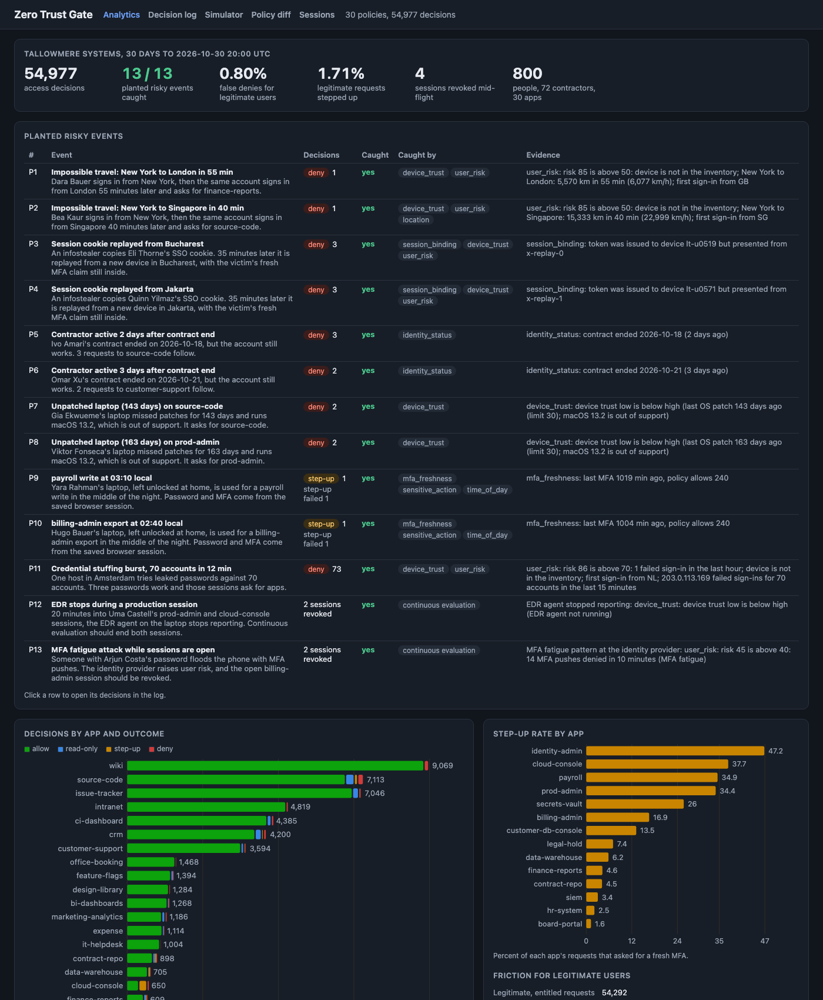

# Zero Trust Gate

An identity-aware access proxy in the zero trust style, for the internal apps of Tallowmere Systems, a made-up 800-person software company. Every request is decided on who the user is, what device they are on, and how risky the context is, never on network location. Policies are YAML per app. Each decision comes with a full trace, a simulator answers "what would happen if", a policy diff replays 30 days of history against a draft before rollout, and open sessions are re-checked and revoked when a laptop falls out of compliance or a user's risk spikes.



## Results on the synthetic company (seed 7)

800 people (72 contractors) in 26 groups, 30 apps from wiki to payroll, 1,269 devices, and 30 days of access attempts: 54,977 decisions. 13 risky events are planted in normal traffic. The policies in `policies/` catch all of them:

| # | Planted event | Requests | Decision | Caught | Caught by |
|---|---|---:|---|---|---|
| P1 | Impossible travel: New York to London in 55 min | 1 | deny | yes | device_trust, user_risk |
| P2 | Impossible travel: New York to Singapore in 40 min | 1 | deny | yes | device_trust, user_risk, location |
| P3 | Session cookie replayed from Bucharest | 3 | deny 3 | yes | session_binding, device_trust, user_risk |
| P4 | Session cookie replayed from Jakarta | 3 | deny 3 | yes | session_binding, device_trust, user_risk |
| P5 | Contractor active 2 days after contract end | 3 | deny 3 | yes | identity_status |
| P6 | Contractor active 3 days after contract end | 2 | deny 2 | yes | identity_status |
| P7 | Unpatched laptop (143 days) on source-code | 2 | deny 2 | yes | device_trust |
| P8 | Unpatched laptop (163 days) on prod-admin | 2 | deny 2 | yes | device_trust |
| P9 | Payroll write at 03:10 local | 1 | step-up, failed | yes | mfa_freshness, sensitive_action, time_of_day |
| P10 | Billing-admin export at 02:40 local | 1 | step-up, failed | yes | mfa_freshness, sensitive_action, time_of_day |
| P11 | Credential stuffing, 70 accounts in 12 min, 3 passwords work | 73 | deny 73 | yes | device_trust, user_risk (IP velocity) |
| P12 | EDR stops during a production session | signal | 2 sessions revoked | yes | continuous evaluation |
| P13 | MFA fatigue attack while sessions are open | signal | 2 sessions revoked | yes | continuous evaluation |

**Friction for legitimate users.** Of 54,292 requests by real staff to apps their groups are entitled to, 433 were denied (**0.80% false denies**, 97 people) and 927 were asked to step up (1.71%, 97% passed). 1,198 got read-only access instead of a deny. Most false denies come from device trust (379: personal phones trying to write, laptops a few weeks behind on patches); 20 come from staff on a commercial VPN whose exit is on the threat feed.

**Least-privilege recommendations** (groups on high and critical apps where under 5% of members used the app in 30 days): remove `engineering` (4 of 210 used it) and `contractors-eng` (0 of 50) from data-warehouse, `product` from source-code (0 of 40), and `sales-managers` from finance-reports (0 of 12).

What the numbers say:
- Layers matter. Attackers rarely trip only one check: the cookie replays fail session binding, device trust, and user risk at once. The contractor (P5, P6) is the exception, caught only because policies require an active identity, which is why the CI gate's negative test turns exactly that off.
- Step-up is where the friction goes. The critical apps (identity-admin 47%, cloud-console 38%, payroll 35%) ask for fresh MFA on a third or more of requests because writes need MFA in the last 15 minutes. The diff tool shows what loosening that would let through: relaxing payroll removes 38 step-ups and lets P9 in.
- The generator and the policies were written together, so these numbers are a regression baseline for the method, not a measured detection rate. `make report` prints them.

## Why

VPNs and office networks grant access by location: once inside, a stolen laptop or a phished session reaches everything. Zero trust access (BeyondCorp, identity-aware proxies, ZTNA products) replaces that with a decision on every request using identity, device posture, and risk. The hard parts are not the proxy. They are writing policies people can reason about, explaining every deny to a help desk, knowing what a policy change will do before it ships, ending sessions when signals change mid-day, and keeping friction low enough that staff do not route around it. This repo shows each of those on a laptop with synthetic data.

## Architecture

```
 browser / client                       admin service (policy decision point)            :8861
 token + X-Device-Id  ┌─────────────┐   POST /api/decide  ┌──────────────────────────────────────┐
 ───────────────────► │ proxy :8862 │ ──────────────────► │ token check, revocation check        │
                      │ (enforcer)  │ ◄────────────────── │ identity status, groups              │
                      │             │  decision + headers │ device trust from posture            │
                      │             │                     │ user risk (failures, travel, intel)  │
                      │             │  X-ZT-User, Groups, │ policy YAML per app -> trace         │
                      │             │  Device-Trust,      │ sessions, step-up challenges         │
                      │             │  signed Assertion   │ signals -> continuous evaluation     │
                      └─────┬───────┘                     │ decision log, analytics, diff, UI    │
                            │                             └──────────────────────────────────────┘
               ┌────────────┴───────────┐
               ▼                        ▼
        wiki backend :8863      payroll backend :8864   (accept only a valid signed assertion)
```

- **Proxy** (`proxy.py`): reads the session token (cookie or bearer), checks the HMAC signature locally, asks the decision point, strips any client-supplied `X-ZT-*` headers, injects identity headers plus a signed, 60-second assertion, and forwards. Step-up becomes a 401 with a challenge id. If the decision point is down it fails closed with a 503. `X-Device-Id` stands in for a device certificate on mTLS.
- **Policy engine** (`policy.py`): ten checks in a fixed order (authentication, session binding, identity status, groups, device trust, user risk, MFA freshness, sensitive action, time of day, location). Every check runs and reports, so the trace explains the whole decision. Precedence: deny, then step-up, then allow with restrictions (read-only), then allow. A step-up satisfies risk and hours step-ups but never a deny.
- **Device trust** (`posture.py`): each failed posture signal caps the device: unmanaged, no disk encryption, no screen lock, EDR stopped, patches older than 30 / 90 / 180 days, unsupported OS. Trust is the lowest cap: high, medium, low, or untrusted.
- **User risk** (`risk.py`): failed sign-ins in the last hour (6 each, up to 30), unregistered device (25), impossible travel by haversine distance and implied speed over 900 km/h (50), first sign-in from a country (10), threat feed hit (40), IP failing for 10 or more accounts in 15 minutes (45), and identity provider signals such as MFA fatigue. Capped at 100.
- **Engine** (`engine.py`): one code path for the 30-day replay and live requests. Keeps sessions per user, device, and app with the policy's lifetime, runs the step-up flow, and re-evaluates open sessions when a posture or risk signal arrives.
- **Analytics** (`analytics.py`): decisions by app and outcome, step-up rates, planted event results, friction, least privilege, and the policy diff.

Example policy (`policies/payroll.yaml`):

```yaml
app: payroll
sensitivity: critical
allow_groups: [payroll-admins]
deny_groups: [contractors]
device:
  min_trust: high
risk:
  step_up_above: 20
  deny_above: 40
mfa:
  max_age_minutes: 240
step_up:
  actions: [write, export, admin]
  mfa_max_age_minutes: 15
hours:
  start: 6
  end: 22
  outside: step_up
location:
  allowed_countries: [US, CA, GB, DE, IE, IN, PT]
session:
  lifetime_minutes: 60
  bind_to_device: true
```

## How to run

Needs [uv](https://docs.astral.sh/uv/). Docker is optional: the Docker files are built and smoke tested in CI.

```bash
cd zero-trust-gate
uv sync --python 3.12
make report        # planted events, friction, least privilege (about 6 seconds)
make demo          # the proxy end to end, in one process
make stack         # admin + UI on :8861, proxy on :8862, backends on :8863 and :8864
```

Open http://127.0.0.1:8861 for the UI: analytics, the decision log with filters and a trace for every decision, the policy simulator, the policy diff, and active and revoked sessions with a revoke button. Light and dark mode follow the system setting.

With `make stack` running, the same demo runs over real HTTP:

```bash
uv run ztgate demo --admin http://127.0.0.1:8861 --proxy http://127.0.0.1:8862
```

```
[ok ] 200  sign in as kofi.ueda@tallowmere.example on lt-u0408
[ok ] 200  GET /wiki/handbook through the proxy
        backend saw kofi.ueda@tallowmere.example groups=hr,all-employees,payroll-admins trust=high
[ok ] 200  GET /payroll/runs (read)
[ok ] 401  POST /payroll/runs 40 minutes later: write needs fresh MFA
        sensitive_action: write needs MFA in the last 15 min
[ok ] 200  answer the MFA step-up challenge
[ok ] 200  POST /payroll/runs again
[ok ] 403  replay the same token from another device
        session_binding: token was issued to device lt-u0408 but presented from x-unknown-laptop
[ok ] 401  tampered token
        session token: bad signature
[ok ] 200  EDR stops on the laptop: continuous evaluation
        revoked 1 session(s): EDR agent stopped reporting: device_trust: device trust low is below high (EDR agent not running)
[ok ] 401  GET /payroll/runs after revocation
```

Other commands:

```bash
make gate          # the CI gate: exit 1 unless every planted event is caught and false denies are under 2%
make gate-weak     # the gate on examples/policies-weak (a loosened payroll and source-code policy): fails on P5 and P9
make diff          # replay the loosened payroll policy: 38 requests newly allowed, including P9
uv run ztgate validate policies
docker compose up --build   # needs ZTGATE_SIGNING_KEY in .env (see .env.example)
```

The service clock starts where the 30-day log ends (2026-10-30 20:00 UTC) and moves with the wall clock, so history and live sessions share one timeline. `POST /api/clock/advance` moves it forward for demos; set `ZTGATE_DEMO_CLOCK=0` to turn that off.

### API

| Method | Path | What |
|---|---|---|
| POST | `/api/decide` | The decision point the proxy calls: token, app, action, device, IP |
| POST | `/api/login`, `/api/stepup` | Identity provider stand-in: sign in, answer a step-up challenge |
| GET | `/api/policies`, `/api/policies/{app}` | Parsed policies and their YAML |
| POST | `/api/policies/validate` | Validate a draft |
| POST | `/api/simulate` | What-if: user, app, action, device or posture overrides, city or IP, hour, MFA age, failed sign-ins, previous location, session type, optional draft policy |
| POST | `/api/diff` | Replay a draft policy over the app's 30 days: transitions, newly allowed and denied requests, planted events exposed |
| GET | `/api/decisions`, `/api/decisions/{id}` | Search the log (app, outcome, user, planted, false denies, text) and the full trace |
| GET | `/api/sessions` | Active, revoked, or expired sessions |
| POST | `/api/sessions/{id}/revoke` | Revoke now; the proxy refuses the token on the next request |
| POST | `/api/signals` | Posture or risk change, re-evaluates open sessions and returns what was revoked |
| GET | `/api/analytics`, `/api/summary` | Everything in the dashboard |
| GET | `/healthz`, `/metrics` | Health and Prometheus metrics (decisions, revocations, planted caught, false deny rate, latency) |

Logs are JSON, one object per line, for every decision, revocation, and proxy request.

## Tests

110 tests, about 25 seconds (`make test`):
- Policy parsing and validation: 16 malformed policies with the exact error, defaults, overlay loading.
- Each condition type, decision precedence, and that a step-up never overrides a deny.
- Device trust levels for every posture signal and caching across posture changes.
- Risk components one by one, bands, expiry of signal events, the 100 cap.
- Haversine distances against known city pairs, impossible travel speed and the short-hop rule, synthetic IP geolocation.
- Step-up flow (passed, failed, MFA refreshed), sessions and lifetimes, continuous evaluation revoking only the sessions that now fail.
- Signed tokens: round trip, expiry, tampered payload, tampered signature, truncation, wrong key, wrong purpose.
- Proxy: identity header injection, spoofed header stripping, no token, tampered token, unknown route, fail closed when the decision point is down, backends refusing requests that skip the proxy, cookie replay from another device, admin revoke ending access.
- Policy diff (no change, loosened, tightened), planted event detection and which control caught each, least-privilege recommendations, the gate failing on the weak overlay.
- API end to end, including the full demo flow through the proxy.

## Production notes

- **Device identity**: `X-Device-Id` would be a device certificate checked on mTLS at the proxy, and posture would stream from MDM and EDR webhooks instead of an inventory in memory.
- **State**: sessions, revocations, and the decision log would live in Redis and a log store (or a stream into the SIEM), so several proxy replicas and decision point replicas share them. Revocation would push to proxies rather than wait for the next request.
- **Latency**: the decision point would sit next to each proxy with policies and posture cached locally, keeping p99 under a few milliseconds; the replay engine would run as a batch job for the diff and the CI gate.
- **Keys**: HMAC keys would move to asymmetric signing (the proxy and backends verify with a public key) with rotation through a KMS.
- **Risk**: real signals come from the identity provider, threat feeds, and user behavior baselines, and their weights would be tuned on labeled incidents instead of set by hand.
- **Policy workflow**: policy changes would go through pull requests where CI posts the diff (newly allowed, newly denied, planted or past incidents exposed) and owners of each app approve.

## License

MIT. See [LICENSE](LICENSE).
